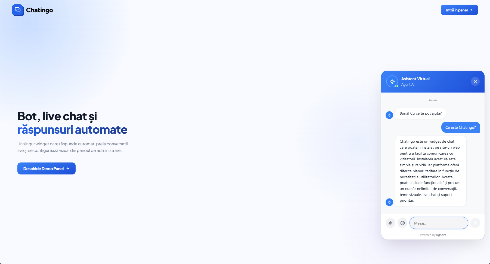
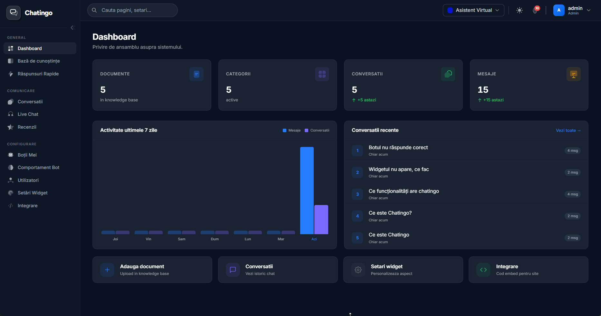
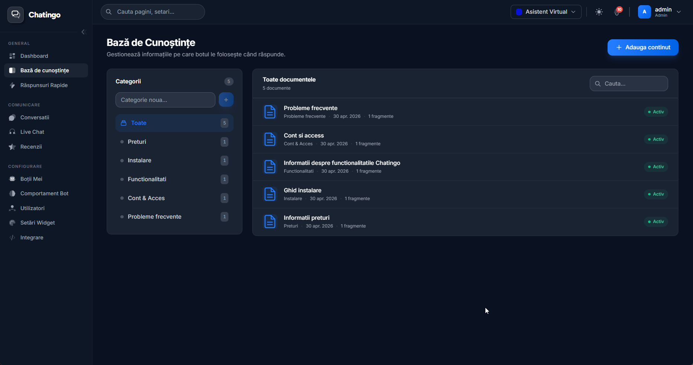
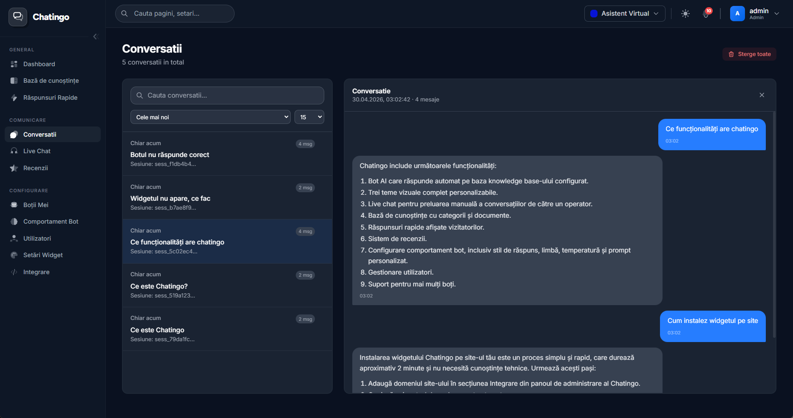
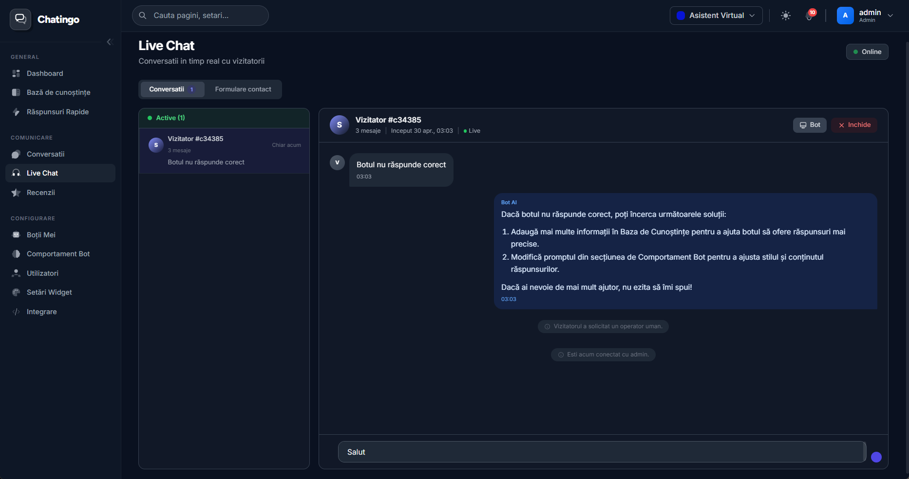
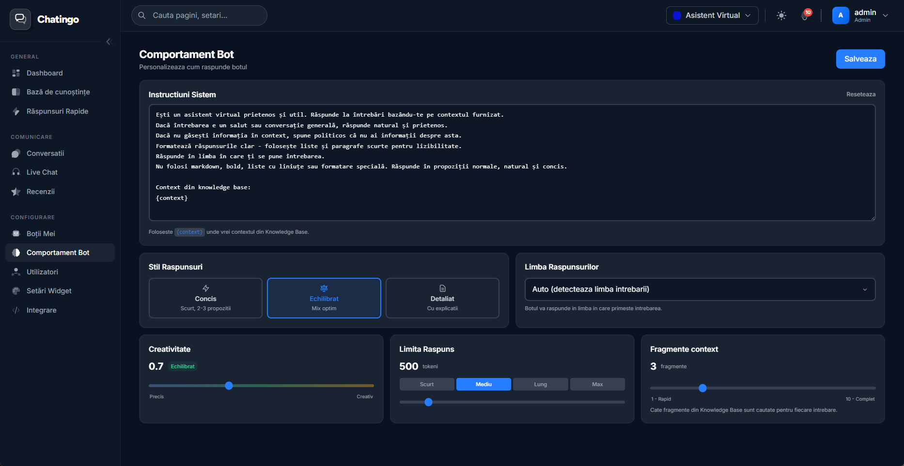
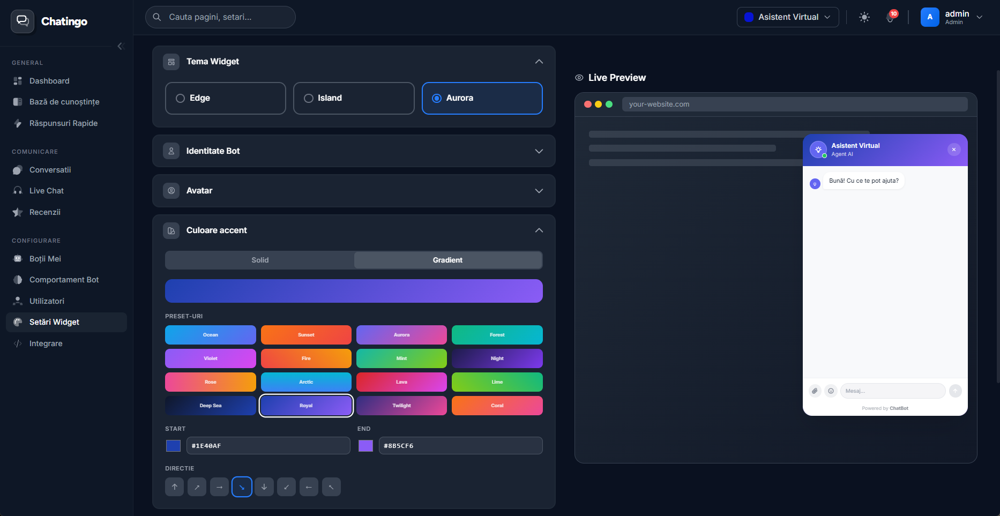
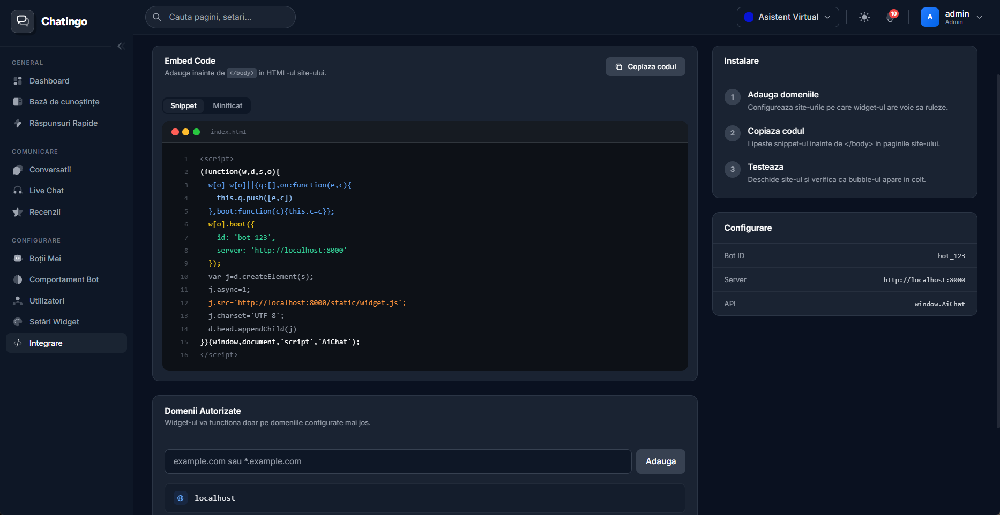

# Chatingo

Chatingo este o platformă de chat pentru site-uri web, care combină un bot cu răspunsuri automate, preluarea manuală a conversațiilor de către un operator uman și un panou de administrare din care totul se configurează vizual. Widget-ul se instalează pe orice site printr-un singur snippet de cod.

Proiect realizat de Grasu Robert-Nicolae. Acest repository conține doar o prezentare vizuală, fără codul sursă. Pentru mai multe detalii, mă puteți contacta la robert.grasu@rgsoft.ro

**Demo live:** [chat.rgsoft.ro](https://chat.rgsoft.ro/login?demo=1)

---

## Ce face aplicația

- Bot care răspunde automat pe baza documentelor proprii, indexate într-o bază vectorială. La fiecare întrebare se caută fragmentele relevante și se trimit ca context modelului de limbaj.
- Live chat cu preluare de operator uman, la cererea vizitatorului.
- Bază de cunoștințe organizată pe categorii, cu documente activabile individual, din fișiere PDF, DOCX și text.
- Configurare a comportamentului botului.
- Personalizare vizuală a widget-ului, cu previzualizare live.
- Răspunsuri rapide afișate vizitatorului ca sugestii, grupate pe categorii.
- Sistem de recenzii, cu note și comentarii lăsate de vizitatori la finalul conversației.
- Suport pentru mai mulți boți în aceeași instalare, fiecare cu date complet separate.
- Restricționarea widget-ului pe domenii autorizate, astfel încât codul embed să funcționeze doar pe site-urile permise.
- Gestionare de utilizatori administratori, cu autentificare și roluri.

## Stack tehnic

| Categorie | Tehnologii |
|---|---|
| Frontend | React, Tailwind CSS |
| Widget | React, Webpack |
| Backend | Python, FastAPI |
| Bază de date | PostgreSQL, SQLAlchemy |
| Căutare semantică | ChromaDB |
| Model de limbaj | OpenAI API |
| Infrastructură | Docker |

---

## Capturi de ecran

### Pagina publică de start
Prezintă platforma și include widget-ul funcțional, deschis în colț. Vizitatorul poate purta o conversație reală cu botul direct din pagina de prezentare.

### Dashboard administrare
Oferă o privire de ansamblu asupra sistemului: număr de documente, categorii, conversații și mesaje, grafic de activitate pe ultimele șapte zile, lista conversațiilor recente și acces rapid la modulele principale.

### Bază de cunoștințe
Grupează pe categorii documentele din care botul își extrage răspunsurile. Fiecare document afișează categoria, data adăugării, numărul de fragmente rezultate în urma indexării și starea activ sau inactiv.

### Conversații
Păstrează istoricul complet al discuțiilor purtate de bot, cu căutare, sortare și identificator de sesiune. La selectarea unei conversații se afișează firul integral de mesaje, cu marcaj de timp.

### Live Chat
Afișează conversațiile active în timp real. Se vede momentul în care vizitatorul a solicitat un operator uman și preluarea discuției de către administrator. Include și un tab separat pentru formularele de contact primite.

### Comportament bot
Controlează modul în care răspunde botul: promptul de sistem cu marcajul unde se inserează contextul din baza de cunoștințe, stilul răspunsurilor, limba, nivelul de creativitate, limita de tokeni și câte fragmente sunt căutate pentru fiecare întrebare.

### Setări widget
Personalizează aspectul widget-ului: tema, identitatea și avatarul botului, culoarea accent ca gradient cu preseturi și direcție reglabilă. Modificările se văd imediat în previzualizarea din dreapta, într-o fereastră de browser simulată.

### Integrare
Generează codul embed care se lipește în site, disponibil în variantă lizibilă sau minificată, alături de pașii de instalare și lista domeniilor pe care widget-ul are voie să ruleze.

